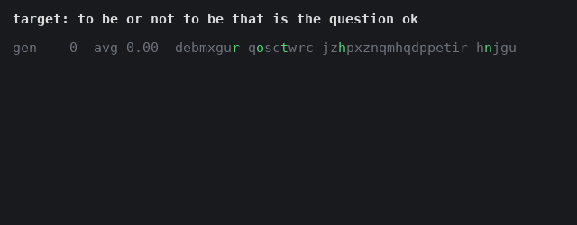
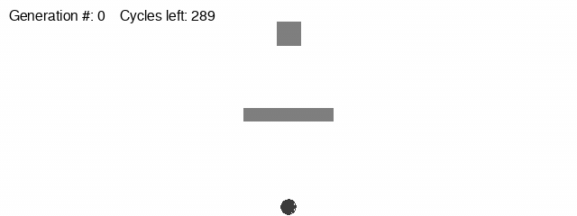
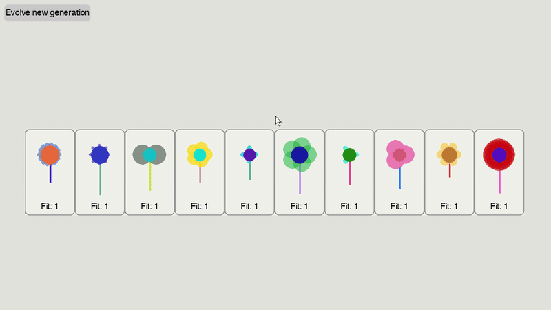
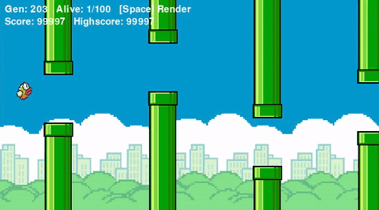
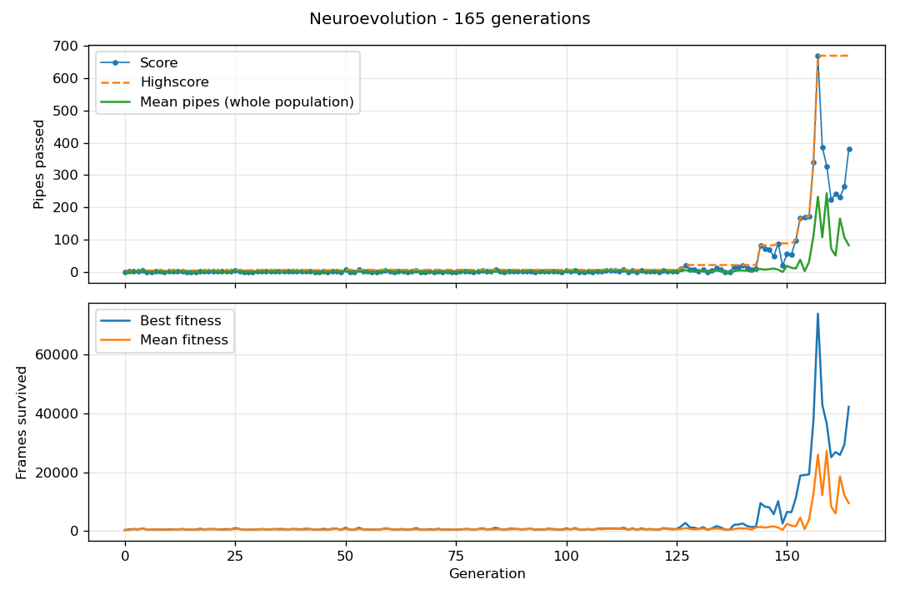

# Evolutionary AI in Python

Genetic algorithms, neural networks and neuroevolution in Python, built with **pygame**, **NumPy** and **Keras**.

> **Inspiration:** These projects are inspired by the book
> [*The Nature of Code*](https://natureofcode.com/) by [Daniel Shiffman](https://shiffman.net/),
> chapters 9–11 (Evolutionary Computing, Neural Networks, Neuroevolution). The book's examples are
> written in JavaScript with p5.js and ml5.js; the projects here are Python implementations written
> from scratch.

| Project | Topic | Tech |
|---|---|---|
| [Phrase finder](#phrase-finder) | Genetic algorithm | Python, Matplotlib |
| [Smart rockets](#smart-rockets) | Genetic algorithm in a physics simulation | pygame |
| [Interactive selection](#interactive-selection) | User-driven evolution | pygame |
| [Gesture classifier](#gesture-classifier) | Supervised learning | Keras, scikit-learn, pandas |
| [Flappy Bird](#flappy-bird-neuroevolution) | Neuroevolution | NumPy, pygame |

## Getting started

Requires Python 3.11+.

```bash
git clone https://github.com/Romanahmad32/evolutionary-ai-python.git
cd evolutionary-ai-python
python -m venv .venv
source .venv/bin/activate        # Windows: .venv\Scripts\activate
pip install -r requirements.txt
```

All programs are started from the repository root with `python -m`.

## Projects

### Phrase finder



A population of random strings evolves until it matches the target phrase
*"to be or not to be that is the question ok"*. Fitness is the squared share of correct characters;
parents are picked with fitness-proportional selection, combined with single-point crossover and
mutated. The average fitness per generation is plotted at the end.

```bash
python -m evolutionary_computing.phrase_finder.main
```

### Smart rockets



*Generations 0, 15 and 40.*

Each rocket's DNA is a sequence of force vectors, one per frame. After every lifespan the rockets
are rated by their closest distance to the target, how fast they reached it, and whether they
crashed, and the next generation is bred from them. Over the generations they learn to fly around
the obstacle.

**Click** to move the target.

```bash
python -m evolutionary_computing.smart_rockets.main
```

### Interactive selection



*Picking only red flowers: after five generations the whole population is red.*

There is no fitness function here: you are the fitness function. Every flower is drawn from
14 genes (colors, petal count and size, stem length). **Hovering** over a flower increases its
fitness, and **"Evolve new generation"** breeds the next generation from your favorites.

```bash
python -m evolutionary_computing.interactive_selection.main
```

### Gesture classifier


A small neural network (2 → 16 ReLU → 4 softmax) that recognizes swipe directions from the
drag vector.

1. **Collect data:** arrow keys choose the label, drag with the mouse to record samples, `S` saves
   them to `gesture_data.csv` (this overwrites the existing dataset).
   ```bash
   python -m neural_networks.gesture_classifier.data_collection
   ```
2. **Train:** run [`training.ipynb`](neural_networks/gesture_classifier/training.ipynb) in Jupyter.
   It saves `gesture_model.keras` and `label_encoder.pkl`.
3. **Use:** draw a swipe and the model predicts its direction.
   ```bash
   python -m neural_networks.gesture_classifier.main
   ```

A trained model is included, so step 3 works right away.

### Flappy Bird neuroevolution



*Generation 203: the best bird passes its 100,000th pipe.*

100 birds, each controlled by its own neural network (5 inputs → 16 ReLU → 2 outputs) written in
NumPy. The networks are never trained with backpropagation; instead the best birds are selected,
crossed over and mutated each generation, and the best bird is carried over unchanged (elitism).

- **Inputs:** height, velocity, distance to the top and bottom of the next pipe, horizontal distance to it
- **Fitness:** frames survived, with passed pipes weighted heavily
- **Performance:** the forward pass for the whole population is one batched `einsum` call instead of
  100 separate ones, which makes the fast mode possible

Press **Space** to switch between normal rendering and fast mode (200 simulation steps per frame).
Every generation is logged to `metrics.csv`.

```bash
python -m neuroevolution.flappy_bird.main
python -m neuroevolution.flappy_bird.plot_metrics   # plot the metrics of the last run
```

Example run: after about 140 generations the birds start to pass pipes reliably, with a best score
of 669 pipes in generation 157.



## Project structure

```
evolutionary_computing/
├── dna.py, population.py     # base classes shared by the genetic algorithms
├── phrase_finder/
├── smart_rockets/
└── interactive_selection/
neural_networks/
└── gesture_classifier/
neuroevolution/
└── flappy_bird/
    ├── assets/
    └── example_results/
```

## Credits

- Inspired by [*The Nature of Code*](https://natureofcode.com/) by [Daniel Shiffman](https://shiffman.net/).
  The whole book can be read for free online.
<!-- TODO: add the source of the Flappy Bird sprites in neuroevolution/flappy_bird/assets/ -->

## License

[MIT](LICENSE)
